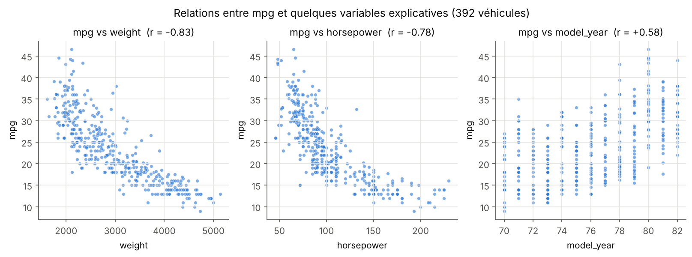
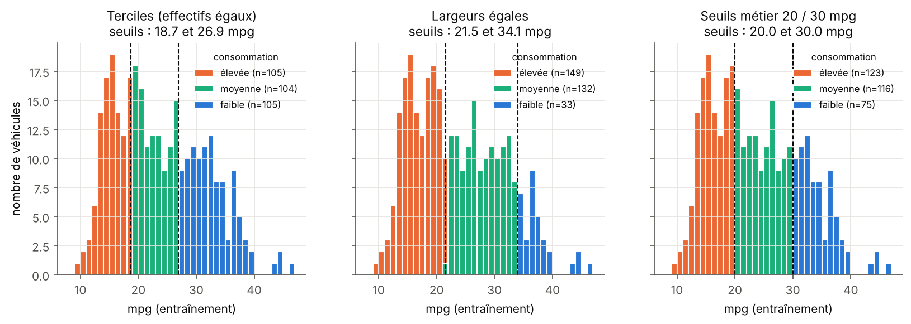
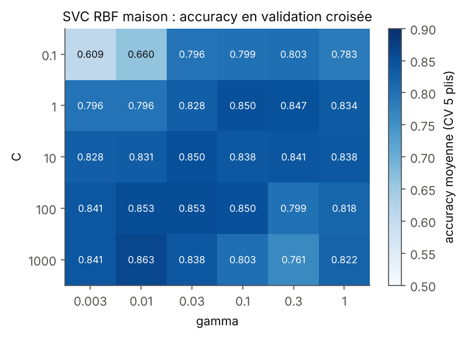
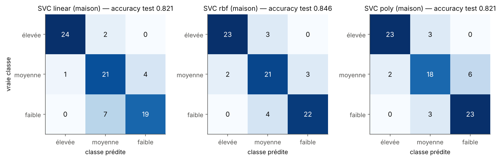
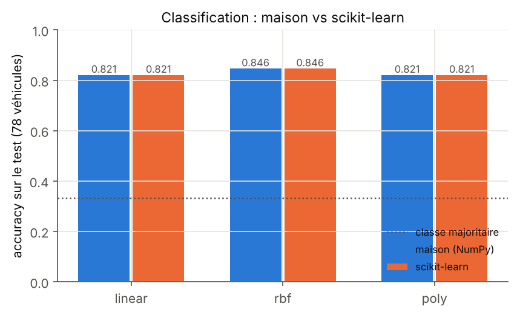
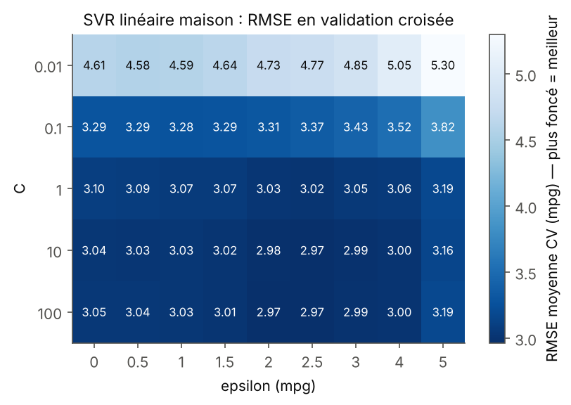
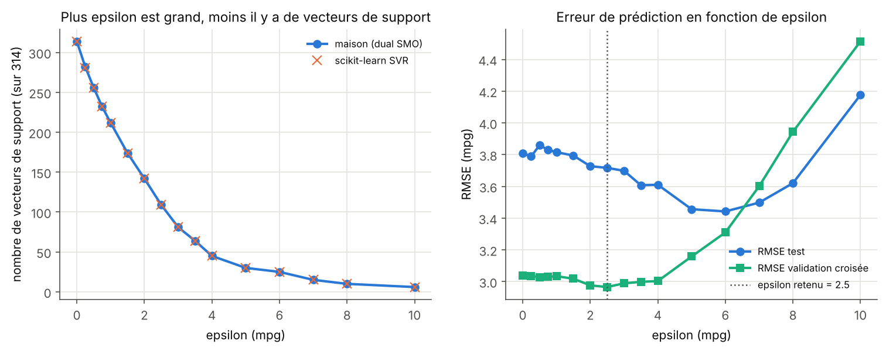
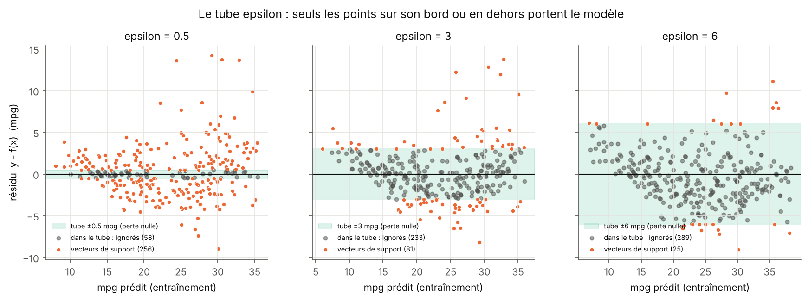
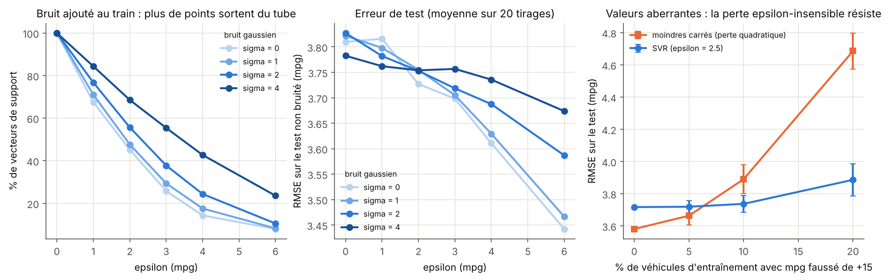

# Consommation de carburant (Auto MPG) par SVM — SVC et SVR implémentés depuis zéro


> **Objectif de l'énoncé.** Approcher la consommation de carburant des véhicules de la base « Auto MPG »
> (1) comme une **classification** (SVC linéaire et à noyaux) après discrétisation de `mpg` en trois classes,
> (2) comme une **régression** (SVR linéaire, perte ε-insensible) en étudiant l'influence de ε sur le nombre de
> vecteurs de support et sur la capacité du modèle à ignorer le bruit. Pour chaque approche : pipeline de
> prétraitement justifié, implémentation **depuis le tout début**, comparaison avec **scikit-learn**.


---

## Sommaire

0. [Résumé des résultats](#0-résumé-des-résultats)
1. [Lancer le projet (pas à pas)](#1-lancer-le-projet-pas-à-pas)
2. [Organisation du dépôt](#2-organisation-du-dépôt)
3. [Les données](#3-les-données)
4. [Pipeline de prétraitement justifié](#4-pipeline-de-prétraitement-justifié)
5. [Rappels théoriques](#5-rappels-théoriques)
6. [Ce qui est implémenté « depuis zéro » et comment c'est vérifié](#6-ce-qui-est-implémenté-depuis-zéro-et-comment-cest-vérifié)
7. [Partie 1 — Classification (SVC)](#7-partie-1--classification-svc)
8. [Partie 2 — Régression (SVR)](#8-partie-2--régression-svr)
9. [Tableau de toutes les valeurs choisies](#9-tableau-de-toutes-les-valeurs-choisies)
10. [Limites et pistes d'amélioration](#10-limites-et-pistes-damélioration)
11. [Reproductibilité](#11-reproductibilité)

---

## 0. Résumé des résultats

| | Résultat principal |
|---|---|
| **Données** | 398 véhicules, 6 sans `horsepower` → **392** ; découpage stratifié **314 entraînement / 78 test** |
| **Discrétisation retenue** | **terciles** de `mpg` (seuils 18,73 et 26,93 mpg, appris sur le train) → 3 classes de **même effectif** (105 / 104 / 105) |
| **SVC linéaire** (C = 0,1) | accuracy test **0,821** (64/78), 173 vecteurs de support |
| **SVC RBF** (C = 1000, γ = 0,01) | accuracy test **0,846** (66/78), 107 vecteurs de support — meilleur modèle |
| **SVC polynomial** (C = 100, d = 4, γ = 0,03, coef0 = 1) | accuracy test **0,821** (64/78), 110 vecteurs de support |
| **SVR linéaire** (C = 10, ε = 2,5 mpg) | RMSE test **3,72 mpg**, MAE 2,66 mpg, R² **0,783**, 109 vecteurs de support sur 314 |
| **Maison vs scikit-learn** | sur les **96** combinaisons SVC et les **45** combinaisons SVR testées en validation croisée : mêmes scores (écart max. 0,0000 en accuracy, 0,0001 mpg en RMSE), **mêmes vecteurs de support**, **100 %** de prédictions identiques sur le test |
| **Influence de ε** | ε = 0 → 314 VS (100 %) ; ε = 2,5 → 109 (35 %) ; ε = 5 → 30 (10 %) ; ε = 10 → 6 (2 %). Au-delà de ~4 mpg, le modèle ignore trop de points et l'erreur de validation remonte |
| **Robustesse** | avec 20 % de valeurs `mpg` faussées (+15 mpg), la RMSE test des moindres carrés passe de 3,58 à **4,69** mpg, celle du SVR de 3,72 à **3,89** seulement |

---

## 1. Lancer le projet (pas à pas)

### 1.1 Prérequis

* **Python 3.9 ou plus récent** (testé avec 3.11, 3.12 et 3.13). Vérifier avec `python --version`
  (sous macOS/Linux, la commande peut s'appeler `python3`).
* Une connexion Internet n'est **pas** obligatoire : si `seaborn.load_dataset('mpg')` échoue, le programme
  utilise automatiquement la copie locale `data/auto_mpg.csv` (copie exacte des données seaborn).

### 1.2 Installation

Ouvrir un terminal **dans le dossier du projet** (celui qui contient `main.py`), puis :

**Windows (PowerShell ou Invite de commandes)**

```bat
python -m venv .venv
.venv\Scripts\activate
python -m pip install --upgrade pip
pip install -r requirements.txt
```

> Si PowerShell refuse d'activer l'environnement (« l'exécution de scripts est désactivée »), lancer une fois
> `Set-ExecutionPolicy -Scope CurrentUser RemoteSigned`, puis recommencer l'activation.

**macOS / Linux**

```bash
python3 -m venv .venv
source .venv/bin/activate
python -m pip install --upgrade pip
pip install -r requirements.txt
```

### 1.3 Exécution

```bash
python main.py                 # tout le projet (~2 à 4 minutes selon la machine)
python -m pytest -q            # 14 tests automatiques : chaque brique maison comparée à scikit-learn (~5 s)
python verifier_bornes_grilles.py   # facultatif (~20 s) : vérifie qu'aucun optimum n'est au bord des grilles
```

Options de `main.py` :

| option | effet |
|---|---|
| `--offline` | n'essaie pas Internet, lit directement `data/auto_mpg.csv` |
| `--full-scratch` | les 560 entraînements répétés des études de bruit utilisent aussi le SVR maison (≈ 3 à 5 min de plus) |

Sortie attendue (extrait) :

```
[1/5] Chargement et préparation des données ...
      source : seaborn.load_dataset('mpg') | 398 lignes brutes, 6 sans horsepower -> 392 véhicules
      train = 314 | test = 78 | 11 variables après prétraitement
[2/5] Exploration ...
[3/5] Comparaison des stratégies de discrétisation de mpg ...
[4/5] Classification SVC (linéaire, RBF, polynomial) : maison vs scikit-learn ...
[5/5] Régression SVR linéaire, influence de epsilon, bruit ...
Terminé en 122 s. Résultats : results/RESULTS.md, results/tables/*.csv, results/figures/*.png
```

---

## 2. Organisation du dépôt

```
svm-auto-mpg/
├── README.md                    ← ce document
├── requirements.txt             ← bibliothèques nécessaires
├── main.py                      ← POINT D'ENTRÉE : exécute tout et régénère results/
├── verifier_bornes_grilles.py   ← contrôle facultatif des grilles d'hyperparamètres
├── pytest.ini                   ← configuration des tests
├── data/
│   └── auto_mpg.csv             ← copie locale des données seaborn (398 lignes, secours hors ligne)
├── src/
│   ├── svm_scratch/             ← ★ LES MODÈLES ÉCRITS DEPUIS ZÉRO (NumPy uniquement)
│   │   ├── kernels.py           ← noyaux linéaire, RBF, polynomial
│   │   ├── smo.py               ← solveur SMO du problème dual (cœur du projet)
│   │   ├── svc.py               ← SVC binaire (dual) + multiclasse un-contre-un
│   │   ├── svr.py               ← ε-SVR (dual) + perte ε-insensible
│   │   └── primal.py            ← SVC et SVR linéaires résolus dans le PRIMAL (sous-gradient)
│   ├── preprocessing.py         ← standardisation, one-hot, discrétisation, découpages (depuis zéro)
│   ├── metrics.py               ← accuracy, accuracy équilibrée, F1 macro, RMSE, MAE, R² (depuis zéro)
│   ├── model_selection.py       ← recherche sur grille par validation croisée (depuis zéro)
│   ├── data.py                  ← chargement + nettoyage
│   ├── plotting.py              ← style commun des figures
│   └── experiments/
│       ├── common.py            ← découpage train/test commun aux deux problèmes
│       ├── discretization.py    ← exploration + comparaison des discrétisations
│       ├── classification.py    ← Partie 1 (SVC)
│       └── regression.py        ← Partie 2 (SVR, ε, bruit)
├── tests/
│   └── test_scratch.py          ← 14 tests : maison == scikit-learn
└── results/                     ← tout est régénéré par main.py
    ├── RESULTS.md               ← résumé chiffré automatique
    ├── summary.json             ← tous les résultats au format JSON
    ├── tables/*.csv             ← tableaux détaillés
    └── figures/*.png            ← figures
```

**Règle importante :** scikit-learn n'est utilisé que pour **comparer** (et dans les tests). Les modèles maison,
le prétraitement maison, les métriques et la validation croisée n'importent que NumPy (et pandas pour lire
le tableau de données).

---

## 3. Les données

**Source.** `seaborn.load_dataset('mpg')` : la base « Auto MPG » (UCI, Quinlan 1993) contient des voitures
des années 1970 à 1982. **Cible :** `mpg` (*miles per gallon*), soit le nombre de miles parcourus avec un gallon
américain. **Attention au sens :** un `mpg` élevé correspond à une consommation faible. Conversion :
L/100 km = 235,215 / mpg (1 gallon US = 3,785 L, 1 mile = 1,609 km).

| variable | type | rôle / commentaire |
|---|---|---|
| `displacement` | continue | cylindrée (pouces cubes) |
| `horsepower` | continue | puissance (ch) — **6 valeurs manquantes** |
| `weight` | continue | poids (livres) — variable la plus corrélée à mpg (r = −0,83) |
| `acceleration` | continue | temps de 0 à 60 mph (s) : plus c'est grand, plus la voiture est lente |
| `model_year` | continue | année du modèle (70 à 82) : progrès technique, r = +0,58 |
| `cylinders` | catégorielle | 3, 4, 5, 6 ou 8 cylindres (3 → 4 voitures, les Mazda à moteur rotatif ; 5 → 3 voitures) |
| `origin` | catégorielle | usa (245), japan (79), europe (68) |
| `name` | texte | nom du modèle — **supprimé** |

Corrélations avec `mpg` (392 véhicules) : weight −0,83 ; displacement −0,81 ; horsepower −0,78 ;
cylinders −0,78 ; model_year +0,58 ; acceleration +0,42.



**Nettoyage (`src/data.py`).**

1. **Suppression des 6 véhicules sans `horsepower`** → 392 véhicules (le nombre annoncé par l'énoncé).
   Pourquoi ne pas imputer ? Il ne s'agit que de 1,5 % des données. De plus, la puissance est très liée à la
   cible : une valeur imputée (moyenne, médiane…) serait inventée et introduirait du bruit artificiel.
2. **Suppression de `name`** : c'est un identifiant presque unique, pas une caractéristique physique. Le modèle
   ne pourrait pas en tirer une règle valable pour un véhicule nouveau.

On obtient **5 variables continues et 2 catégorielles**, comme l'indique l'énoncé.

---

## 4. Pipeline de prétraitement justifié

Le même pipeline sert aux deux problèmes (fichiers `src/preprocessing.py` et `src/experiments/common.py`) :

```
392 véhicules
   │  1. découpage stratifié 80 % / 20 % (graine 42)        → 314 train / 78 test
   │  2. apprentissage des paramètres SUR LE TRAIN UNIQUEMENT :
   │       - moyenne et écart-type des 5 variables continues
   │       - modalités de cylinders et origin, modalité de référence
   │       - seuils de discrétisation de mpg (partie 1)
   │  3. transformation du train ET du test avec ces paramètres
   ▼
matrice de 11 colonnes : 5 continues standardisées + 4 indicatrices cylinders + 2 indicatrices origin
```

**1. Découpage train/test stratifié (80/20, graine 42).** On garde 78 véhicules de côté. Ils ne servent qu'à
l'évaluation finale et ne sont jamais vus pendant le réglage. Le découpage est **stratifié sur les terciles de
mpg** : le train et le test couvrent alors toute la plage de consommation dans les mêmes proportions (26 véhicules
de chaque classe dans le test). Le **même** découpage sert à la classification et à la régression, ce qui rend les
deux parties comparables. 20 % est un compromis classique : assez de test pour estimer l'erreur, assez de train
pour apprendre. Avec 392 exemples, 78 voitures de test signifie qu'**une voiture vaut 1,3 point d'accuracy** :
c'est pourquoi les choix sont faits par validation croisée et non sur le test.

**2. Standardisation des variables continues : $x' = (x - \mu)/\sigma$.** C'est indispensable pour un SVM.
* La marge $1/\lVert w\rVert$ et la pénalité $\lVert w\rVert^2$ dépendent de l'échelle. Sans standardisation,
  `weight` (≈ 1600 à 5100 livres) écraserait `acceleration` (≈ 8 à 25 s).
* Le noyau RBF $\exp(-\gamma\lVert x-z\rVert^2)$ repose sur des **distances**. Sans standardisation, la distance
  ne refléterait que le poids.
* Le solveur SMO converge beaucoup plus vite sur des données bien conditionnées.

$\mu$ et $\sigma$ sont calculés **sur le train seulement**. Les calculer sur toutes les données ferait « fuiter »
de l'information du test vers le modèle.

**3. Encodage one-hot des variables catégorielles, avec une modalité de référence.** `cylinders` et `origin`
sont catégorielles (énoncé). Un codage numérique 0/1/2 pour `origin` imposerait un ordre et des distances qui
n'existent pas (« japan » n'est pas « entre » usa et europe). On crée donc une colonne 0/1 par modalité, **sauf
la plus fréquente** (4 cylindres, usa), qui sert de référence. Sans cette suppression, les colonnes d'une même
variable somment toujours à 1 et sont colinéaires avec l'intercept *b* (« piège des variables indicatrices »).
Nous l'avons constaté : les prédictions restaient identiques, mais les coefficients de ces colonnes changeaient
d'un solveur à l'autre et n'étaient pas interprétables. Avec une référence, chaque coefficient se lit comme un
**écart par rapport à une voiture américaine à 4 cylindres**. Les colonnes 0/1 ne sont pas standardisées : elles
sont déjà sur une échelle comparable et restent lisibles. (Remarque : `cylinders` est en fait ordinal. Le traiter
comme catégoriel, comme le demande l'énoncé, laisse le modèle libre de ne pas supposer un effet linéaire du
nombre de cylindres. Ce choix se justifie : les 3 « cylindres » de la base sont des moteurs rotatifs Mazda.)

**4. Cible.** Pour la régression, `mpg` est **laissé dans son unité** : ε s'exprime alors directement en mpg
(« les erreurs de moins de 2,5 mpg sont ignorées »), ce qui rend l'étude de ε interprétable. Pour la
classification, voir la discrétisation (§7.1).

---

## 5. Rappels théoriques

### 5.1 SVM à marge souple (classification binaire, $y_i \in \{-1,+1\}$)

On cherche un hyperplan $f(x) = w\cdot\phi(x) + b$ qui sépare les deux classes avec la **plus grande marge**,
tout en tolérant des erreurs. C'est le problème **primal** :

$$\min_{w,b}\ \frac12\lVert w\rVert^2 + C\sum_{i=1}^n \max\bigl(0,\ 1 - y_i f(x_i)\bigr)$$

* $\frac12\lVert w\rVert^2$ : maximiser la marge, qui vaut $2/\lVert w\rVert$ (régularisation).
* $\max(0, 1-y_if(x_i))$ : la **perte charnière** (*hinge loss*). Elle est nulle si le point est bien classé et
  hors de la marge, et croît linéairement sinon.
* **C** règle le compromis. C petit : marge large, erreurs tolérées, modèle simple. C grand : on veut classer
  correctement le train quitte à réduire la marge (risque de sur-apprentissage).

**Problème dual** (obtenu par les multiplicateurs de Lagrange) :

$$\max_{\alpha}\ \sum_i\alpha_i - \frac12\sum_{i,j}\alpha_i\alpha_j y_i y_j K(x_i,x_j)
\quad\text{s.c.}\quad 0\le\alpha_i\le C,\ \ \sum_i\alpha_i y_i = 0$$

et $f(x) = \sum_i \alpha_i y_i K(x_i, x) + b$. Conditions KKT :
* $\alpha_i = 0$ : point bien classé hors de la marge, **inutile** au modèle ;
* $0<\alpha_i<C$ : point **sur** la marge ($y_if(x_i)=1$) : vecteur de support « libre » ;
* $\alpha_i = C$ : point dans la marge ou mal classé : vecteur de support « borné ».

Les **vecteurs de support** (VS) sont les points avec $\alpha_i>0$. Le modèle ne dépend que d'eux.

### 5.2 Noyaux

Le dual ne fait intervenir les données qu'à travers des produits scalaires. On remplace donc
$\phi(x)\cdot\phi(z)$ par un **noyau** $K(x,z)$, ce qui revient à travailler dans un espace transformé sans le
calculer (« astuce du noyau ») :

| noyau | formule | paramètres |
|---|---|---|
| linéaire | $K(x,z)=x\cdot z$ | — (frontière = hyperplan) |
| RBF (gaussien) | $K(x,z)=\exp(-\gamma\lVert x-z\rVert^2)$ | γ : portée de l'influence d'un point. γ petit : frontière lisse, proche du linéaire ; γ grand : frontière très locale (sur-apprentissage) |
| polynomial | $K(x,z)=(\gamma\, x\cdot z + c_0)^d$ | d : degré ; c₀ = coef0 ; γ : échelle |

Ces définitions sont **exactement** celles de scikit-learn (vérifié par un test).

### 5.3 Le solveur SMO (Sequential Minimal Optimization)

Le dual est un problème quadratique de taille *n*. SMO (Platt, 1998) le résout en optimisant **deux** variables
à la fois. Il en faut au moins deux, sinon la contrainte $\sum\alpha_iy_i=0$ serait violée. Le sous-problème à
deux variables a une **solution analytique** (on « coupe » ensuite pour rester dans $[0, C]$). À chaque itération :

1. on calcule $G = Q\alpha + p$ (gradient), avec $Q_{ij}=y_iy_jK_{ij}$ ;
2. on choisit $i$ = la variable qui viole le plus les conditions KKT, puis $j$ = celle qui fait **le plus
   baisser l'objectif** (règle du second ordre de Fan, Chen & Lin 2005, utilisée par LIBSVM) ;
3. on met à jour $\alpha_i,\alpha_j$ analytiquement puis $G$ en O(n) ;
4. on s'arrête quand la violation KKT maximale $m(\alpha)-M(\alpha) < 10^{-3}$ (tolérance par défaut de
   scikit-learn).

Le seuil *b* est déduit des conditions KKT : moyenne sur les VS libres.

### 5.4 Multiclasse : un-contre-un (One-vs-One)

Avec 3 classes on entraîne $3\times2/2 = 3$ SVM binaires (élevée/moyenne, élevée/faible, moyenne/faible). Chacun
vote, et la classe qui a le plus de voix gagne (en cas d'égalité, la plus petite étiquette). C'est la stratégie
de `sklearn.svm.SVC`, ce qui rend la comparaison exacte. Un point est vecteur de support s'il l'est dans **au
moins un** des 3 sous-problèmes.

### 5.5 SVR et perte ε-insensible

En régression, on veut $f(x)=w\cdot x+b$ proche de $y$, **sans pénaliser les petites erreurs** :

$$L_\varepsilon(y, f(x)) = \max\bigl(0,\ |y - f(x)| - \varepsilon\bigr)$$

Cette perte définit un **tube** de demi-largeur ε autour de $f$ : un point à l'intérieur du tube coûte 0, un point
à l'extérieur coûte sa distance au bord du tube (pénalité linéaire, donc **robuste** aux grosses erreurs,
contrairement au carré). Problème primal :

$$\min_{w,b}\ \frac12\lVert w\rVert^2 + C\sum_i \max\bigl(0, |y_i - w\cdot x_i - b| - \varepsilon\bigr)$$

Dual (variables $\alpha_i, \alpha_i^*\in[0,C]$) :

$$\min_{\alpha,\alpha^*}\ \frac12(\alpha-\alpha^*)^\top K(\alpha-\alpha^*) + \varepsilon\sum_i(\alpha_i+\alpha_i^*) - \sum_i y_i(\alpha_i-\alpha_i^*)
\quad\text{s.c.}\ \sum_i(\alpha_i-\alpha_i^*)=0$$

avec $f(x)=\sum_i(\alpha_i-\alpha_i^*)K(x_i,x)+b$ et, pour le noyau linéaire, $w=\sum_i(\alpha_i-\alpha_i^*)x_i$.
Ce dual a la **même forme** que celui du SVC (2n variables empilées). Le **même solveur SMO** sert donc aux deux.

**Lecture des vecteurs de support en SVR** (conditions KKT) :
* $|y_i - f(x_i)| < \varepsilon$ (strictement dans le tube) ⇒ $\alpha_i=\alpha_i^*=0$ : le point est **ignoré** ;
* $|y_i - f(x_i)| = \varepsilon$ (sur le bord) ⇒ $0<|\alpha_i-\alpha_i^*|<C$ : VS **libre** ;
* $|y_i - f(x_i)| > \varepsilon$ (hors du tube) ⇒ $|\alpha_i-\alpha_i^*| = C$ : VS **borné**.

Donc **augmenter ε élargit le tube**, plus de points tombent dedans et **moins il y a de vecteurs de support**.
C'est le mécanisme par lequel le modèle « ignore » les petites fluctuations (le bruit) des données.

---

## 6. Ce qui est implémenté « depuis zéro » et comment c'est vérifié

| brique | fichier | contenu |
|---|---|---|
| noyaux | `src/svm_scratch/kernels.py` | linéaire, RBF, polynomial, `gamma='scale'` |
| solveur SMO | `src/svm_scratch/smo.py` | dual générique, sélection du second ordre, calcul de b, critère KKT |
| SVC | `src/svm_scratch/svc.py` | `BinarySVC` (dual), `OneVsOneClassifier`, `SVCScratch` |
| SVR | `src/svm_scratch/svr.py` | `SVRScratch` (dual à 2n variables), perte ε-insensible |
| primal | `src/svm_scratch/primal.py` | `LinearSVCPrimal`, `LinearSVRPrimal` : **la perte apparaît explicitement dans le code** ; descente de sous-gradient, pas $\eta_t=\eta_0/\sqrt t$, moyenne des itérés |
| prétraitement | `src/preprocessing.py` | standardisation, one-hot avec référence, discrétisation, découpages stratifiés, k-fold |
| métriques | `src/metrics.py` | matrice de confusion, accuracy, accuracy équilibrée, F1 macro, RMSE, MAE, R² |
| validation croisée | `src/model_selection.py` | grille + règle parcimonieuse |

**Pourquoi deux solveurs pour le linéaire ?** Le dual (SMO) donne la solution exacte et les vecteurs de support.
Le primal montre la fonction de perte **telle qu'elle est écrite dans l'énoncé** (charnière / ε-insensible) et
permet un **contrôle croisé** : deux méthodes indépendantes doivent atteindre le même optimum.

**Vérifications automatiques** (`python -m pytest -q`, 14 tests, tous réussis) :
1. 392 lignes et 11 colonnes après prétraitement ;
2. noyaux maison = noyaux scikit-learn ;
3. prétraitement maison = `ColumnTransformer(StandardScaler, OneHotEncoder(drop=…))` de scikit-learn ;
4. métriques maison = métriques scikit-learn ;
5. découpages disjoints et stratifiés ;
6. SVC maison (linéaire, RBF, poly) : ≥ 99 % de prédictions identiques à `sklearn.svm.SVC`, même nombre de VS (±2) ;
7. SVC binaire : contraintes $0\le\alpha\le C$ et $\sum\alpha_iy_i=0$ respectées, **saut de dualité** primal − dual < 0,1 % ;
8. SVR maison = `sklearn.svm.SVR(kernel='linear')` pour ε ∈ {0 ; 1 ; 3} (prédictions, VS, coefficients) ;
9. solveurs primaux : objectif à moins de 1 % de l'optimum dual ;
10. discrétisation : classe 0 = consommation élevée (mpg bas), bornes correctement affectées.

---

## 7. Partie 1 — Classification (SVC)

### 7.1 Discrétisation de la cible : quelle stratégie ?

On transforme `mpg` en 3 classes **ordonnées** : *élevée* (mpg bas), *moyenne*, *faible* (mpg haut). Trois
stratégies ont été comparées. Leurs **seuils sont appris sur le train** (pas de fuite). Elles sont toutes évaluées
avec **le même modèle de référence non réglé** (SVC RBF maison, C = 1, γ = 'scale', valeurs par défaut de
scikit-learn) : ainsi on juge la difficulté de la **cible**, pas la qualité du réglage. Évaluation par validation
croisée stratifiée à 5 plis sur le train.

| stratégie | seuils (mpg) | seuils (L/100 km) | effectifs train élevée / moyenne / faible | déséquilibre max/min | % près d'un seuil (±1 mpg) | classe majoritaire (test) | accuracy CV | **accuracy équilibrée CV** | F1 macro CV |
|---|---|---|---|---|---|---|---|---|---|
| **terciles (retenue)** | 18,73 / 26,93 | 12,6 / 8,7 | **105 / 104 / 105** | **1,01** | 18,2 % | 0,333 | 0,834 | **0,834** | **0,835** |
| largeurs égales | 21,53 / 34,07 | 10,9 / 6,9 | 149 / 132 / 33 | 4,52 | 13,1 % | 0,423 | 0,844 | 0,728 | 0,743 |
| seuils métier 20 / 30 | 20,00 / 30,00 | 11,8 / 7,8 | 123 / 116 / 75 | 1,64 | 11,5 % | 0,359 | 0,831 | 0,826 | 0,827 |



**Impact sur l'équilibre des classes.**
* **Largeurs égales** : la distribution de mpg est asymétrique (beaucoup de voitures entre 13 et 30 mpg, peu
  au-delà de 34). La classe « faible consommation » ne compte que **33 véhicules sur 314**, avec un rapport de
  1 à 4,5. Le modèle y gagne une **accuracy trompeuse** (0,844, la plus haute) : il suffit de bien classer les
  deux grosses classes. Son **accuracy équilibrée chute à 0,728** et son F1 macro à 0,743 : la classe rare est
  mal reconnue. Un classifieur trivial qui répond toujours « élevée » obtient déjà 42 % sur le test.
* **Seuils métier (20 et 30 mpg ≈ 11,8 et 7,8 L/100 km)** : faciles à interpréter, mais légèrement déséquilibrés (75 contre 123).
* **Terciles** : classes **parfaitement équilibrées**. Accuracy, accuracy équilibrée et F1 macro coïncident, le
  hasard vaut 1/3, aucune pondération des classes n'est nécessaire et les 3 classes pèsent autant dans
  l'apprentissage.

**Impact sur la difficulté du problème.** La difficulté vient des voitures proches d'un seuil : une voiture à
18,5 mpg et une autre à 19,0 mpg sont presque identiques mais tombent dans deux classes différentes. Avec les
terciles, les seuils tombent dans la partie **dense** de la distribution, donc **18,2 %** des véhicules du train
sont à moins de 1 mpg d'un seuil (contre 11,5 % avec les seuils métier). Le problème est donc intrinsèquement un
peu **plus difficile** : la limite n'est pas « naturelle ». Mais ce coût est faible (accuracy équilibrée 0,834
contre 0,826) au regard du gain : une évaluation honnête et des classes de même poids.

**Choix : terciles**, appris sur le train (18,73 et 26,93 mpg). C'est la stratégie qui donne le problème le plus
équilibré, avec la meilleure accuracy équilibrée et le meilleur F1 macro. Elle s'adapte aussi aux données :
« élevée / moyenne / faible » veut dire « tiers le plus gourmand / médian / le plus sobre » du parc étudié.

### 7.2 Protocole de réglage

* **Validation croisée stratifiée à 5 plis** sur les 314 véhicules d'entraînement. 5 plis : chaque modèle est
  évalué sur ~63 véhicules à chaque fois, avec un coût de calcul raisonnable. C'est le choix standard.
* **Les mêmes plis et la même grille** servent au modèle maison et à scikit-learn (`src/model_selection.py`).
* **Critère : accuracy.** Les classes étant équilibrées, elle est ici équivalente à l'accuracy équilibrée.
* **Grilles (échelle logarithmique,** car l'effet de C et γ est multiplicatif) :

| noyau | grille | nb. de combinaisons |
|---|---|---|
| linéaire | C ∈ {0,001 ; 0,01 ; 0,1 ; 1 ; 10 ; 100} | 6 |
| RBF | C ∈ {0,1 ; 1 ; 10 ; 100 ; 1000} × γ ∈ {0,003 ; 0,01 ; 0,03 ; 0,1 ; 0,3 ; 1} | 30 |
| polynomial | C ∈ {0,1 ; 1 ; 10 ; 100 ; 1000} × d ∈ {2 ; 3 ; 4} × γ ∈ {0,01 ; 0,03 ; 0,1 ; 0,3}, coef0 = 1 | 60 |

  *coef0 = 1* : le noyau $(\gamma x\cdot z+1)^d$ contient tous les termes de degré 0 à d (interactions **et**
  effets simples). Avec coef0 = 0 il ne contiendrait que les termes de degré exactement d.
* **Règle de choix parcimonieuse.** Parmi les combinaisons à moins de **1 %** du meilleur score CV, on prend le
  **plus petit C** (modèle le plus régularisé), puis le meilleur score. Raison : l'écart-type du score entre plis
  vaut ≈ 0,02 à 0,05. Des différences de moins de 1 % ne sont donc pas significatives, et un C plus petit
  généralise au moins aussi bien. Le simple « meilleur score » est aussi enregistré (colonne `meilleur_brut`
  des fichiers `results/tables/02_cv_*.csv`).
* **Bornes des grilles vérifiées** : `verifier_bornes_grilles.py` relance la sélection avec des grilles beaucoup
  plus larges (C jusqu'à 10⁵, γ de 3·10⁻⁴ à 3, degré jusqu'à 5). Les **mêmes** hyperparamètres sont choisis :
  aucun optimum n'est au bord d'une grille.

### 7.3 Résultats

| noyau | hyperparamètres retenus | accuracy CV (5 plis) | **accuracy test** | accuracy équilibrée test | F1 macro test | nb. de VS (sur 314) |
|---|---|---|---|---|---|---|
| linéaire | C = 0,1 | 0,841 | **0,821** (64/78) | 0,821 | 0,822 | 173 |
| RBF | C = 1000, γ = 0,01 | 0,863 | **0,846** (66/78) | 0,846 | 0,848 | 107 |
| polynomial | C = 100, d = 4, γ = 0,03, coef0 = 1 | 0,860 | **0,821** (64/78) | 0,821 | 0,819 | 110 |
| *linéaire, solveur primal maison* | C = 0,1 | — | 0,821 | 0,821 | 0,822 | — |
| *classe majoritaire* | — | — | 0,333 | 0,333 | — | — |

Pour le linéaire, le meilleur score brut était C = 100 (0,847). La règle parcimonieuse choisit C = 0,1 (0,841),
1000 fois plus régularisé, pour un écart inférieur à 1 %.





**Interprétation.**
* Les trois SVM font **beaucoup mieux que le hasard** (0,82 à 0,85 contre 0,33).
* **Aucune voiture « élevée » n'est classée « faible » ni l'inverse** : les coins des 3 matrices de confusion
  valent 0. Toutes les erreurs se font entre classes **voisines**, autour des seuils. C'est cohérent avec le §7.1 :
  la difficulté vient de la frontière arbitraire entre deux classes adjacentes, pas d'une mauvaise compréhension
  du problème.
* **Linéaire vs noyaux.** Le noyau RBF améliore la validation croisée (0,863 contre 0,841) et le test
  (+2 voitures). La relation entre mpg et les variables n'est pas linéaire (mpg décroît de façon convexe avec
  le poids, voir la figure du §3). Une frontière courbe s'adapte donc mieux. La figure ci-dessous l'illustre en
  2 dimensions (poids et année seulement, à titre de visualisation). Les écarts restent modestes : sur 78
  véhicules de test, 2 voitures font 2,6 points. Linéaire et polynomial sont à égalité sur le test (64/78) bien
  que le polynomial soit meilleur en CV. **Les conclusions reposent donc sur la CV, plus fiable que les 78
  voitures de test.**
* **Vecteurs de support.** Le linéaire à C = 0,1 (marge large) utilise 173 VS (55 % du train). Les modèles à
  noyau, avec un C grand, ont une marge plus étroite et seulement 107 à 110 VS : la frontière plus souple « pose »
  sur moins de points.
* **γ = 0,01 est petit** : chaque point influence une large zone, donc la frontière RBF reste lisse. Elle est
  compensée par un C grand (1000). La heatmap montre la diagonale classique « petit γ ↔ grand C » : des
  combinaisons de complexité équivalente donnent des scores proches.


### 7.4 Comparaison avec scikit-learn

| | linéaire | RBF | polynomial |
|---|---|---|---|
| combinaisons de la grille | 6 | 30 | 60 |
| écart maximal de score CV maison / sklearn | 0,0000 | 0,0000 | 0,0000 |
| hyperparamètres retenus | identiques | identiques | identiques |
| accuracy test maison / sklearn | 0,821 / 0,821 | 0,846 / 0,846 | 0,821 / 0,821 |
| nb. de VS maison / sklearn | 173 / 173 | 107 / 107 | 110 / 110 |
| prédictions test identiques | 100 % | 100 % | 100 % |
| temps d'entraînement maison / sklearn (indicatif) | 0,007 s / 0,002 s | 0,087 s / 0,003 s | 0,047 s / 0,002 s |



**Conclusion.** Notre implémentation résout **exactement le même problème** que `sklearn.svm.SVC` : même dual,
même règle de choix de la paire (i, j), même tolérance, même stratégie un-contre-un. Elle obtient les mêmes
solutions sur les **96** combinaisons testées. La seule différence est la **vitesse** (4 à 30 fois plus lent) :
LIBSVM est écrit en C++ compilé et utilise une heuristique de *shrinking* (il retire provisoirement les variables
déjà fixées à 0 ou C). Notre version est en Python/NumPy, dans un souci de lisibilité. Le solveur primal
(sous-gradient), totalement indépendant, retrouve les mêmes prédictions (100 %). C'est une validation croisée des
deux implémentations.

> Remarque : `sklearn.svm.LinearSVC` n'a pas été utilisé pour la comparaison du SVC linéaire. Il résout un
> problème **différent** par défaut (perte charnière au carré, intercept pénalisé, stratégie un-contre-tous). La
> comparaison ne serait pas « à problème égal ». `SVC(kernel='linear')` résout exactement notre problème.

---

## 8. Partie 2 — Régression (SVR)

### 8.1 Protocole

* Mêmes 314 / 78 véhicules et même prétraitement. Cible `mpg` en mpg.
* **Validation croisée à 5 plis** (non stratifiée : la cible est continue), critère **RMSE** (erreur
  quadratique moyenne, en mpg).
* Grille : C ∈ {0,01 ; 0,1 ; 1 ; 10 ; 100} × ε ∈ {0 ; 0,5 ; 1 ; 1,5 ; 2 ; 2,5 ; 3 ; 4 ; 5} (45 combinaisons),
  même règle parcimonieuse (§7.2). ε va de 0 (aucun point ignoré) à 5 mpg, soit plus que l'écart-type du bruit
  résiduel (≈ 2,9 mpg, voir §8.4).



**Choix : C = 10, ε = 2,5 mpg** (RMSE CV = 2,966 mpg, aussi le meilleur score brut). C = 0,01 et 0,1 sont trop
régularisés (RMSE CV au mieux 4,58 et 3,28). Entre C = 10 et 100 la différence est négligeable. Le solveur maison est en
revanche environ 30 fois plus lent à C = 100 : c'est l'intérêt concret de la règle parcimonieuse.

### 8.2 Résultats et comparaison des implémentations

| modèle | RMSE test (mpg) | MAE test (mpg) | R² test | nb. de VS | objectif primal sur le train |
|---|---|---|---|---|---|
| **SVR maison — dual SMO** | **3,717** | 2,659 | **0,783** | **109** | 1809,707 |
| SVR maison — primal sous-gradient | 3,716 | 2,660 | 0,784 | — | 1809,726 |
| `sklearn.svm.SVR(kernel='linear')` | 3,717 | 2,659 | 0,783 | 109 | 1809,703 |
| `sklearn.svm.LinearSVR` | 3,708 | 2,647 | 0,784 | — | 1812,424 |
| *référence : moindres carrés (OLS)* | 3,581 | 2,616 | 0,799 | — | — |
| *référence : moyenne constante* | 8,014 | 6,455 | −0,006 | — | — |

* **Maison = scikit-learn** : écart maximal entre les prédictions test des deux SVR = **0,0014 mpg**, même
  nombre de VS (109). Sur les 45 combinaisons de la grille, l'écart maximal de RMSE CV est de 0,0001 mpg.
* **Saut de dualité** : objectif primal 1809,707, objectif dual 1809,693, soit un écart relatif de 8·10⁻⁶. La
  solution est **optimale** (à la tolérance près).
* **Primal sous-gradient** : il atteint le même objectif à 0,001 % près. C'est la preuve que nous minimisons bien
  la perte ε-insensible écrite dans l'énoncé.
* **`LinearSVR`** (bibliothèque LIBLINEAR) atteint un objectif un peu plus élevé (+0,15 %). Ce n'est pas une
  erreur : LIBLINEAR **pénalise aussi l'intercept** *b* (il le traite comme un coefficient de plus) et utilise
  une autre méthode (descente de coordonnées). Son problème est donc légèrement différent. `SVR(kernel='linear')`
  (LIBSVM) résout exactement le nôtre.
* Le SVR explique **78 % de la variance** de mpg sur le test (RMSE ≈ 3,7 mpg, soit ≈ 1,5 L/100 km autour de
  25 mpg). Les **moindres carrés sont légèrement meilleurs ici** (3,58). C'est attendu sur des données propres
  où le bruit est à peu près gaussien : la perte quadratique est alors optimale. L'intérêt de la perte
  ε-insensible est ailleurs : **parcimonie** (le modèle ne repose que sur 109 points sur 314) et **robustesse**
  (§8.4).

**Coefficients appris** (SVR maison, en mpg pour +1 écart-type d'une variable continue, ou pour la présence
d'une modalité par rapport à la référence « 4 cylindres, usa ») :


### 8.3 Influence de ε sur le nombre de vecteurs de support

C fixé à 10, ε varie de 0 à 10 mpg (`results/tables/03_influence_epsilon.csv`) :

| ε (mpg) | 0 | 0,5 | 1 | 1,5 | 2 | **2,5** | 3 | 4 | 5 | 6 | 8 | 10 |
|---|---|---|---|---|---|---|---|---|---|---|---|---|
| **nb. de VS (maison)** | 314 | 256 | 212 | 174 | 142 | **109** | 81 | 45 | 30 | 25 | 10 | 6 |
| nb. de VS (sklearn) | 314 | 256 | 212 | 174 | 142 | 109 | 81 | 45 | 30 | 25 | 10 | 6 |
| % de VS | 100 | 81,5 | 67,5 | 55,4 | 45,2 | 34,7 | 25,8 | 14,3 | 9,6 | 8,0 | 3,2 | 1,9 |
| % du train strictement dans le tube | 0 | 18,5 | 32,5 | 44,6 | 54,8 | 65,3 | 74,2 | 85,7 | 90,4 | 92,0 | 96,8 | 98,1 |
| VS libres (sur le bord du tube) | 11 | 11 | 11 | 12 | 11 | 11 | 11 | 10 | 11 | 11 | 8 | 6 |
| RMSE validation croisée | 3,038 | 3,027 | 3,034 | 3,018 | 2,976 | **2,966** | 2,989 | 3,003 | 3,158 | 3,310 | 3,944 | 4,514 |
| RMSE test | 3,809 | 3,860 | 3,816 | 3,794 | 3,727 | 3,717 | 3,698 | 3,611 | 3,456 | 3,442 | 3,620 | 4,177 |



**Observations.**
1. **Le nombre de VS décroît de façon monotone avec ε**, de 314 (100 %) à 6 (2 %). Les deux implémentations
   donnent les mêmes nombres (un seul écart de 1 point à ε = 0,25 dans le tableau CSV, dû au *shrinking* de
   LIBSVM qui s'arrête à un point légèrement différent, dans la tolérance).
2. **Vérification de la théorie :** pour chaque ε, « % de VS » + « % strictement dans le tube » = **100 %**
   exactement. Tout point dans le tube est ignoré ($\alpha_i=\alpha_i^*=0$) et tout point sur le bord ou dehors
   est vecteur de support, conformément aux conditions KKT du §5.5. (Les VS libres sont sur le bord à ±0,001 mpg
   près, la tolérance du solveur.)
3. **≈ 11 VS libres quel que soit ε**, soit à peu près le nombre de paramètres du modèle (11 coefficients + *b*).
   Géométriquement, l'hyperplan « repose » sur environ autant de points du bord du tube qu'il a de degrés de
   liberté. Tous les autres VS sont **bornés** (hors du tube, $|\alpha_i-\alpha_i^*|=C$).
4. ε = 0 : la perte devient $|y - f(x)|$ (régression « en valeur absolue », proche de la médiane) et **tous** les
   points sont VS.



### 8.4 Capacité du modèle à ignorer le bruit

Ordre de grandeur du bruit : l'écart-type des résidus des moindres carrés sur le train vaut **σ̂ ≈ 2,92 mpg**.
C'est ce que les variables n'expliquent pas (conditions de mesure, état du véhicule, non-linéarité, etc.).

**(a) ε joue le rôle d'un seuil de bruit.** Avec ε petit devant σ̂ (0 à 1 mpg), le modèle « croit » chaque
fluctuation : presque tous les points tirent sur la solution. Avec **ε ≈ σ̂** (2 à 3 mpg), les points dont
l'écart est de l'ordre du bruit tombent dans le tube et sont ignorés (65 % du train à ε = 2,5). Seuls les points
nettement atypiques façonnent le modèle. C'est là que la RMSE de validation croisée est **minimale** (2,966).
Avec ε ≫ σ̂ (≥ 5 mpg), le tube est si large qu'il ignore aussi le **signal** : 90 % des points ne comptent plus,
le modèle est sous-ajusté et l'erreur CV remonte fortement (4,51 à ε = 10). Il existe donc un ε optimal **du
même ordre que le niveau de bruit**, ce que la littérature recommande (Smola et al. 1998 ; Cherkassky & Ma 2004).
La formule de Cherkassky & Ma, $\varepsilon = 3\hat\sigma\sqrt{\ln n / n}$, donne ici 1,2 mpg. La courbe CV est
très plate entre 1,5 et 4 mpg (2,97 à 3,03), si bien que les deux choix sont pratiquement équivalents.

> **Remarque honnête sur le test :** la RMSE test continue de baisser jusqu'à ε ≈ 6 alors que la CV remonte dès
> ε = 5. Avec seulement 78 véhicules, la RMSE test est elle-même bruitée. Nous gardons le choix de la validation
> croisée (314 véhicules, 5 estimations) : choisir ε d'après le test serait tricher.

**(b) Expérience contrôlée : bruit gaussien ajouté.** On ajoute au mpg d'entraînement un bruit
$\mathcal N(0,\sigma^2)$, σ ∈ {0 ; 1 ; 2 ; 4} mpg, puis on évalue sur le test **non bruité**. Il y a 20 tirages
par configuration et C = 10 (`results/tables/03_bruit_gaussien.csv`).

| σ du bruit ajouté | % VS à ε = 2 | RMSE test ε = 0 | RMSE test ε = 2 | RMSE test ε = 4 | instabilité des coef. ε = 0 | ε = 2 | moindres carrés : RMSE / instabilité |
|---|---|---|---|---|---|---|---|
| 0 | 45,2 % | 3,810 | 3,727 | 3,611 | 0 | 0 | 3,581 / 0 |
| 1 | 47,7 % | 3,822 | 3,755 | 3,629 | 0,468 | **0,316** | 3,587 / 0,264 |
| 2 | 55,7 % | 3,827 | 3,753 | 3,688 | 0,906 | **0,575** | 3,616 / 0,570 |
| 4 | 68,6 % | 3,783 | 3,754 | 3,736 | 1,334 | **1,112** | 3,649 / 1,103 |

(« instabilité » = écart-type moyen des coefficients $w_j$ entre les 20 tirages : plus il est petit, moins le
modèle est perturbé par le bruit.)

* À ε fixé, **plus il y a de bruit, plus les points sortent du tube** : à ε = 2, la part de VS passe de 45 % à
  69 %. Pour continuer à ignorer le bruit, **ε doit grandir avec σ**.
* Un ε > 0 **stabilise les coefficients** par rapport à ε = 0 : 0,316 contre 0,468 pour σ = 1 et 0,575 contre
  0,906 pour σ = 2, soit environ un tiers de variabilité en moins. Les petites perturbations restent dans le tube
  et ne déplacent pas la solution.
* L'erreur de test ne se dégrade presque pas (3,73 → 3,75 à ε = 2, même avec σ = 4). Le SVR linéaire, avec 314
  points et une forte régularisation, « moyenne » le bruit.
* **Honnêtement :** face à un bruit **gaussien**, les moindres carrés restent un peu meilleurs (RMSE et
  stabilité). C'est un résultat classique : la perte quadratique est optimale pour un bruit gaussien. L'avantage
  décisif de la perte ε-insensible apparaît avec un bruit **non gaussien** (c).

**(c) Valeurs aberrantes.** On fausse le mpg d'une part des véhicules d'entraînement de **+15 mpg** (une erreur
de saisie grossière). Il y a 20 tirages par taux (`results/tables/03_valeurs_aberrantes.csv`).

| % de véhicules faussés | 0 % | 5 % | 10 % | 20 % |
|---|---|---|---|---|
| RMSE test SVR (ε = 2,5) | 3,717 | 3,719 | 3,737 | **3,886** |
| RMSE test moindres carrés | 3,581 | 3,663 | 3,890 | **4,686** |



Avec 20 % de valeurs aberrantes, les moindres carrés perdent **1,1 mpg** de RMSE, le SVR seulement **0,17**. La
perte ε-insensible croît **linéairement** hors du tube : un point aberrant ne pèse jamais plus que C, quelle que
soit l'ampleur de son erreur ($|\alpha_i-\alpha_i^*|\le C$). Avec la perte quadratique, son influence croît avec
le **carré** de l'erreur et il « tire » toute la droite vers lui. C'est la principale raison d'être de la perte
ε-insensible : **ignorer les petites erreurs (dans le tube) et limiter l'influence des grosses (au-delà)**.

**Conclusion de la partie 2.** ε contrôle directement la **parcimonie** du modèle (nombre de VS) et son niveau
de **tolérance au bruit**. Un ε du même ordre que le bruit (ici 2 à 3 mpg) ignore la majorité des fluctuations
sans perdre le signal. Trop petit, le modèle s'accroche au bruit ; trop grand, il ignore aussi l'information.

---

## 9. Tableau de toutes les valeurs choisies

| valeur | où | ce qu'elle représente | pourquoi cette valeur |
|---|---|---|---|
| `SEED = 42` | `common.py` | graine du générateur aléatoire (découpages, bruit) | rend **tous** les résultats reproductibles ; 42 est une convention, toute autre valeur conviendrait |
| `TEST_SIZE = 0.20` | `common.py` | part des données mises de côté | compromis classique : 78 véhicules pour évaluer, 314 pour apprendre |
| stratification sur terciles | `common.py` | répartition des classes dans le train et le test | même plage de mpg dans les deux ; 26 véhicules de chaque classe en test |
| `N_FOLDS = 5` | `common.py` | nombre de plis de la validation croisée | standard ; ~63 véhicules par pli de validation, coût raisonnable |
| 6 lignes supprimées | `data.py` | véhicules sans `horsepower` | 1,5 % des données ; une imputation inventerait une variable très liée à la cible |
| référence one-hot = modalité la plus fréquente | `preprocessing.py` | colonne supprimée (4 cylindres, usa) | évite la colinéarité avec *b* ; coefficients interprétables |
| 3 classes, terciles | `preprocessing.py` | discrétisation de mpg | énoncé (faible/moyenne/élevée) ; classes équilibrées (§7.1) |
| seuils 18,73 / 26,93 mpg | appris | bornes des classes | terciles du train |
| seuils métier 20 / 30 mpg | `preprocessing.py` | stratégie comparée | valeurs rondes ≈ 11,8 et 7,8 L/100 km |
| ±1 mpg | `discretization.py` | « zone ambiguë » autour d'un seuil | ordre de grandeur de la précision de mpg (valeurs souvent entières) |
| C = 1, γ = 'scale' | `discretization.py` | modèle de référence pour comparer les discrétisations | valeurs par défaut de scikit-learn, **non réglées**, pour juger la cible et non le réglage |
| grilles de C (10⁻³ à 10³) | `classification.py`, `regression.py` | force de la régularisation (inverse) | échelle logarithmique ; bornes vérifiées par `verifier_bornes_grilles.py` |
| grilles de γ (0,003 à 1) | `classification.py` | portée du noyau | données prétraitées ⇒ $\lVert x-z\rVert^2 \approx 10$ en moyenne entre deux voitures ; γ de 0,003 (exp(−0,03) ≈ 1 : presque linéaire) à 1 (exp(−10) ≈ 0 : très local) |
| degrés 2, 3, 4 | `classification.py` | complexité du noyau polynomial | au-delà de 4 : rien de mieux (vérifié jusqu'à 5) et risque numérique |
| `coef0 = 1` | `classification.py` | terme constant du noyau polynomial | inclut aussi les termes de degré < d (§7.2) |
| tolérance 1 % + plus petit C | `model_selection.py` | règle de choix parcimonieuse | écarts < 1 % non significatifs (écart-type CV ≈ 2 à 5 %) ; préférer le modèle le plus simple |
| `tol = 1e-3` | `smo.py` | précision de l'arrêt (violation KKT max.) | valeur par défaut de scikit-learn ⇒ comparaison à précision égale |
| `TAU = 1e-12` | `smo.py` | remplace une courbure ≤ 0 | même garde-fou que LIBSVM (cas de points dupliqués) |
| `max_iter = 1 000 000` | `smo.py` | sécurité anti-boucle infinie | jamais atteint (avertissement sinon) |
| `eta0 = 10`, `n_iter = 30 000` | `primal.py` | pas initial et nombre d'itérations du sous-gradient | réglés empiriquement : objectif à < 1 % de l'optimum dual pour tous les C utilisés |
| pas $\eta_0/\sqrt t$ + moyenne de la 2ᵉ moitié | `primal.py` | schéma de descente | garantie de convergence classique pour une fonction convexe non dérivable ; la moyenne lisse les oscillations |
| grille ε 0 à 5 mpg | `regression.py` | largeur du tube testée en CV | de « aucun point ignoré » à plus que le bruit résiduel (σ̂ ≈ 2,9) |
| ε étudiés 0 à 10 mpg | `regression.py` | étude de l'influence de ε | va jusqu'au sous-ajustement manifeste |
| C = 10, ε = 2,5 | appris (CV) | modèle SVR final | §8.1 |
| σ ∈ {0, 1, 2, 4} mpg | `regression.py` | niveaux de bruit ajoutés | de « aucun » à « plus que le bruit naturel » (≈ 2,9) |
| +15 mpg, 0 à 20 % | `regression.py` | valeurs aberrantes simulées | erreur grossière (≈ 2 écarts-types de mpg), taux réalistes à extrêmes |
| 20 répétitions | `regression.py` | tirages par configuration | moyenne et écart-type stables, temps de calcul raisonnable |
| 1e-3 mpg | `regression.py` | tolérance « strictement dans le tube » | égale à la tolérance du solveur (VS libres sur le bord à ±1e-3) |
| C = 1 / (C = 10, γ = 1) | `classification.py` | modèles de la figure 2D | **illustration uniquement** (2 variables), valeurs choisies pour rendre la différence visible |

---

## 10. Limites et pistes d'amélioration

* **Petit jeu de test (78 véhicules)** : 1 voiture = 1,3 point d'accuracy. Les écarts entre noyaux (2 voitures)
  ne sont pas statistiquement significatifs. Une validation croisée répétée ou imbriquée (*nested CV*) donnerait
  une estimation plus fiable.
* **Relation non linéaire** : mpg décroît de façon convexe avec le poids. Un SVR à noyau RBF, ou un modèle linéaire
  sur L/100 km (≈ proportionnel au poids), ou sur log(mpg), ferait probablement mieux que le SVR **linéaire**
  imposé par l'énoncé.
* **Discrétisation** : les classes sont ordonnées, mais SVC les traite comme nominales. Une approche ordinale
  (ou la régression suivie d'un seuillage) exploiterait cet ordre.
* **Vitesse** : le solveur maison n'a pas le *shrinking* ni le cache de LIBSVM. C'est un choix de lisibilité.
* **Modalités rares** : `cylinders = 3` (4 voitures) et `= 5` (3 voitures) sont trop rares pour des coefficients
  fiables. Le solveur primal converge d'ailleurs lentement dans ces directions (coefficient 0,09 au lieu de 0 pour
  `cylinders_5`), sans effet visible sur les prédictions.

---

## 11. Reproductibilité

* Toutes les sources d'aléa utilisent la graine 42 ; SMO et LIBSVM sont déterministes. Deux exécutions donnent
  **les mêmes chiffres** (seuls les temps de calcul changent).
* Testé avec Python 3.11 + NumPy 1.26 + pandas 1.5 + scikit-learn 1.2 (versions minimales), et avec
  Python 3.12/3.13 + les dernières versions (NumPy 2.5, pandas 3.0, scikit-learn 1.9) : **résultats
  identiques**.
* **NumPy ≥ 1.26 est exigé** : pendant les tests, NumPy 1.23 (avec sa bibliothèque OpenBLAS embarquée) a donné
  des **produits matriciels faux** sur un processeur Intel Xeon récent. L'erreur dépassait 30 sur `A @ A.T`, et
  disparaissait en forçant OpenBLAS sur un noyau générique. Ce n'est pas un défaut du projet : c'est un bogue
  connu des anciennes versions d'OpenBLAS sur certains processeurs. La contrainte de `requirements.txt` l'évite.
* Les chiffres de ce README correspondent à l'exécution consignée dans `results/RESULTS.md` et
  `results/summary.json`.

---

